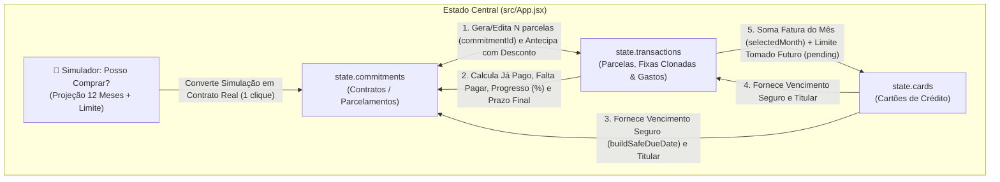
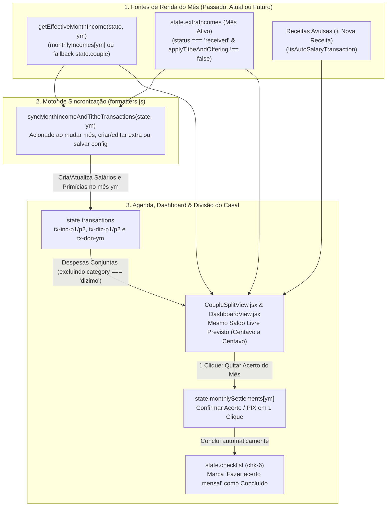
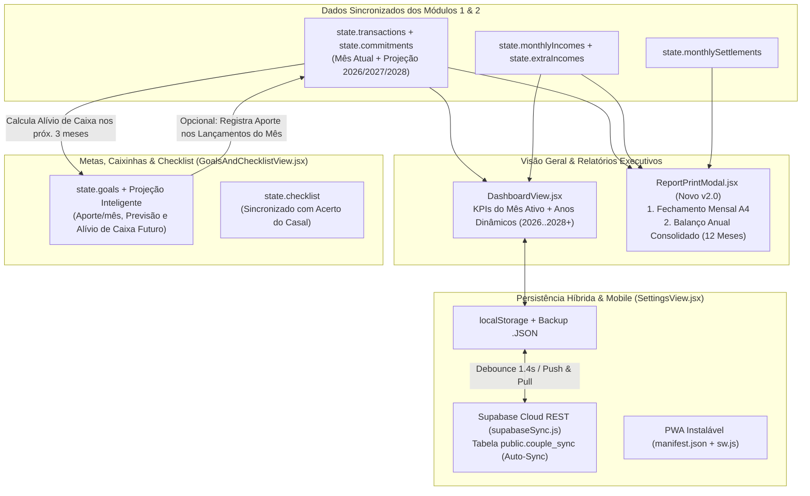

# 🗺️ FLUXOS_DO_SISTEMA.md — Arquitetura de Fluxos e Relacionamento de Dados do FinanPro! (v2.0)

Este documento mapeia de forma detalhada todas as funcionalidades do **FinanPro! | Finanças a Dois (v2.0)**, explicando como os 3 módulos se relacionam, trocam informações entre meses passados, atuais e futuros e mantêm a sincronização em tempo real através do estado central da aplicação (`localStorage` + **Supabase Cloud** + **PWA**).

---

## 📑 Índice de Módulos Mapeados

1. **[Módulo 1: Tríade de Despesas — Parcelados e Fixas, Lançamentos do Mês e Cartões & Faturas](#módulo-1-tríade-de-despesas--parcelados-e-fixas-lançamentos-do-mês-e-cartões--faturas)** *(Atualizado v2.0)*
2. **[Módulo 2: Rendas Mensais, Renda Extra, Primícias (Dízimo/Oferta/Doação) e Divisão do Casal](#módulo-2-rendas-mensais-renda-extra-primícias-dízimoofertadoação-e-divisão-do-casal)** *(Atualizado v2.0)*
3. **[Módulo 3: Visão Geral (Dashboard), Metas & Caixinhas, Relatórios PDF e Nuvem/Configurações](#módulo-3-visão-geral-dashboard-metas--caixinhas-relatórios-pdf-e-nuvemconfigurações)** *(Atualizado v2.0)*
4. **[Módulo 4: Integração Transversal Entre Meses (Passado, Atual e Futuro) & Sincronização Supabase Cloud + PWA](#módulo-4-integração-transversal-entre-meses-passado-atual-e-futuro--sincronização-supabase-cloud--pwa)** *(Novo v2.0)*

---

# Módulo 1: Tríade de Despesas — Parcelados e Fixas, Lançamentos do Mês e Cartões & Faturas

## 1.1. Fonte Única de Verdade e Chaves de Ligação (`src/App.jsx`)

Toda a comunicação entre as abas **Parcelados e Fixas** (`src/components/CommitmentsView.jsx`), **Lançamentos do Mês** (`src/components/TransactionsView.jsx`) e **Cartões e Faturas** (`src/components/CardsView.jsx`) ocorre através do estado global gerenciado em `src/App.jsx` (persistido em `localStorage` sob a chave `finanpro_couple_state_v1` e sincronizado com o **Supabase Cloud**).

As três coleções principais se conectam por duas chaves estrangeiras (`commitmentId` e `cardId`):

* **`state.commitments`** *(Contratos-Mestre)*:
  * Armazena compras parceladas (1x a 36x) e contas fixas recorrentes (ex.: Aluguel, Internet, Seguro).
  * Campos-chave: `id`, `title`, `type` (`installment` | `recurring`), `category`, `totalAmount`, `downPayment`, `installmentsCount`, `startDate`, `endDate`, `paymentMethod`, `cardId`, `owner` (`joint` | `partner1` | `partner2`), `paidBy`, `notes`.
* **`state.transactions`** *(Fluxo de Caixa Mensal e Parcelas Individuais)*:
  * Armazena cada parcela individual gerada por um compromisso, os gastos/receitas avulsos lançados no mês, as contas fixas clonadas e os lançamentos automáticos de Salário (`tx-inc-p1-${ym}`, `tx-inc-p2-${ym}`) e Primícias (`tx-diz-p1-${ym}`, `tx-diz-p2-${ym}`, `tx-don-${ym}`).
  * Campos-chave: `id`, `commitmentId` *(liga ao contrato em `state.commitments`)*, `cardId` *(liga ao cartão em `state.cards`)*, `title`, `type` (`expense` | `income`), `category`, `amount`, `dueDate` (`YYYY-MM-DD`, protegido por `buildSafeDueDate`), `paidDate`, `status` (`pending` | `paid`), `owner`, `paidBy`, `paymentMethod`, `installmentNumber`, `totalInstallments`, `receiptFileName`.
* **`state.cards`** *(Cartões de Crédito do Casal)*:
  * Armazena os cartões cadastrados (ex.: *Inter Platinum — Wesley*, *Nubank Chroma — Beatriz*).
  * Campos-chave: `id`, `name`, `brand`, `owner`, `limit`, `closingDay`, `dueDay`, `color`.

### Diagrama de Relacionamento e Fluxo de Dados (Módulo 1 — v2.0)

---

## 1.2. Detalhamento Funcional de Cada Aba (v2.0)

### A) Aba: Parcelados e Fixas (`src/components/CommitmentsView.jsx`)

* **Propósito:** Visão macro de longo prazo de todos os compromissos que atravessam múltiplos meses, com simulação prévia de compras, edição de contratos e antecipação de parcelas com desconto.
* **🔮 Simulador Inteligente "Posso Comprar?" (*What-If* de Novos Parcelamentos — Novo v2.0):**
  * Painel expansível no topo da aba que projeta os **próximos 12 meses** antes de o casal realizar uma compra.
  * Cruza as rendas previstas e despesas já agendadas de cada mês futuro (`shiftYearMonth`) com a parcela simulada, verifica se o valor total cabe no **Limite Disponível** do cartão escolhido, emite um veredito automático (`✅ Compra Segura`, `⚠️ Atenção` ou `🛑 Risco de Saldo Negativo / Estouro de Limite`), aponta o **Mês Mais Folgado para Iniciar a Compra** e permite converter a simulação em parcelamento real com 1 clique.
* **Indicadores (KPIs do Topo):**
  1. **Volume Total Contratado / Parcelado:** Soma de `totalScheduled` de todos os compromissos filtrados.
  2. **Total Já Amortizado / Quitado:** Soma de todas as parcelas vinculadas (`t.commitmentId === c.id`) com `status === 'paid'`.
  3. **Saldo Devedor Futuro (Para Quitar Tudo):** Diferença exata (`totalScheduled - totalPaid`).
* **Regras de Criação e Integridade Matemática (`Novo Parcelamento / Conta Fixa`):**
  * **Clamp Seguro de Vencimento (`buildSafeDueDate`):** Ajusta automaticamente dias `29`, `30` e `31` para o último dia real de meses mais curtos (ex: `2026-11-30`, `2027-02-28`, `2028-02-29`).
  * **Seletor `Quem Paga (paidBy)` para PIX/Boleto/Débito:** Permite escolher se Wesley ou Beatriz paga a conta quando o meio não é cartão de crédito.
  * **Trava de Entrada Inválida (`installmentPreview.valid`):** Bloqueia submissão caso a entrada inicial seja maior ou igual ao valor total contratado.
  * **Ajuste Automático de Centavos:** Garante que a soma das parcelas (incluindo entrada, se houver) seja **100% idêntica** ao `totalAmount` contratado.
* **Ações por Linha, Edição e Antecipação com Desconto (v2.0):**
  * **Ícone 👁️ (`Ver Cronograma e Antecipar Parcelas`):**
    * Exibe todas as parcelas geradas e inclui o painel **"⚡ Antecipar Parcelas Futuras com Desconto"** (estilo Nubank/Inter): seleciona as `N` últimas parcelas pendentes, aplica o desconto obtido em R\$, traz o vencimento para o `selectedMonth`, recalcula o `totalAmount` do contrato e **libera imediatamente o limite tomado do cartão**.
  * **Ícone ✏️ (`Editar Contrato / Parcelamento` — Novo v2.0):**
    * Abre modal (`handleUpdateCommitment`) permitindo editar título, categoria, divisão (`owner`), cartão/meio de pagamento, pagador (`paidBy`) e reajustar o valor das parcelas futuras pendentes sem alterar as parcelas já pagas.
  * **Ícone 🗑️ (`Excluir Compromisso`):** Solicita confirmação (`window.confirm`) e exclui o contrato e todas as suas parcelas em cascata.

---

### B) Aba: Lançamentos do Mês (`src/components/TransactionsView.jsx`)

* **Propósito:** Agenda e livro-caixa operacional do mês selecionado (`state.selectedMonth`).
* **⚡ Clonagem Automática de Contas Fixas (`Clonar Fixas do Mês Anterior` — Novo v2.0):**
  * Copia em 1 clique as contas fixas recorrentes (Luz, Água, Condomínio, Internet, PIX/Boleto) do mês anterior para o `selectedMonth` com `status: 'pending'` e data ajustada via `buildSafeDueDate`, ignorando itens que já existam no mês para evitar duplicidade.
* **Calendário Interativo de Vencimentos:**
  * Renderiza a grade mensal completa do `selectedMonth` e limpa automaticamente o filtro de dia (`selectedDay`) ao navegar entre meses na Sidebar.
* **Filtro Completo de Categorias (Despesas + Receitas):**
  * O seletor de categorias agrupa todas as categorias de **Despesas** (`CATEGORIES`) e de **Receitas** (`INCOME_CATEGORIES`).
* **Edição Completa de Lançamentos (`✏️ Editar` — Novo v2.0):**
  * Cada linha da tabela possui o botão `✏️ Editar` (`handleOpenEditTransaction`), permitindo corrigir descrição, valor, vencimento, cartão, categoria, divisão e status.
  * Se o lançamento fizer parte de um parcelamento (`commitmentId`), exibe a opção **"Propagar descrição, categoria, cartão e divisão para as demais parcelas pendentes deste parcelamento"** e recalcula automaticamente o `totalAmount` e o `endDate` do contrato-mestre.

---

### C) Aba: Cartões e Faturas (`src/components/CardsView.jsx`)

* **Propósito:** Gestão dos cartões de crédito do casal, separando a **Fatura do Mês Ativo** do **Limite Tomado** com parcelas futuras.
* **Sincronização Reativa da Fatura Aberta (`selectedCardInvoiceId`):**
  * O modal *Ver Fatura* deriva os dados em tempo real do cartão selecionado, atualizando valores e status instantaneamente.
* **Cascata Completa ao Editar Cartão (`handleUpdateCard`):**
  * Alterar o `dueDay` ou o titular (`owner`) de um cartão atualiza todas as parcelas pendentes daquele cartão usando `buildSafeDueDate(ym, dueDayNum)` e sincroniza o `paidBy` e o `endDate` dos contratos vinculados.

---

## 1.3. Matriz de Sincronização Cruzada do Módulo 1 (v2.0)

| Operação Executada | Função em `src/App.jsx` | Efeito em **Parcelados e Fixas** | Efeito em **Lançamentos do Mês** | Efeito em **Cartões e Faturas** |
| :--- | :--- | :--- | :--- | :--- |
| **Simular e Converter Compra ("Posso Comprar?")** | `handleConvertSimulationToReal` $\rightarrow$ `handleAddCommitment` | Preenche o modal com os dados simulados e cria o contrato-mestre com `totalAmount` exato. | Gera as `N` parcelas mensais com datas validadas por `buildSafeDueDate`. | Consome o limite total no cartão selecionado e soma a 1ª parcela na fatura do mês inicial. |
| **Editar Lançamento Individual (`✏️`)** | `handleSaveTransaction` *(modo edição)* | Se for parcela de contrato: recalcula `totalAmount` e `endDate` do contrato; se marcado *Propagar*, atualiza os metadados do contrato. | Atualiza o lançamento no mês ativo (e nas parcelas futuras pendentes, se *Propagar* estiver ativo). | Atualiza imediatamente a fatura do mês e o limite tomado se o valor ou cartão mudou. |
| **Editar Contrato Parcelado (`✏️`)** | `handleUpdateCommitment` | Atualiza título, categoria, divisão, cartão e reajusta o valor das parcelas futuras pendentes. | Propaga as alterações para todas as parcelas `pending` do contrato, preservando as `paid`. | Atualiza o cartão vinculado, datas de vencimento e limite tomado pelas parcelas futuras. |
| **Antecipar Parcelas com Desconto (`⚡`)** | `handleAnticipateInstallments` | Abate o desconto do `totalAmount`, antecipa o `endDate` e eleva o progresso (`%`) do contrato. | Move as últimas `N` parcelas pendentes para o `selectedMonth` com o valor descontado e status `paid` (ou `pending`). | **Libera na hora** o valor original das parcelas quitadas no **Limite Disponível** do cartão. |
| **Clonar Contas Fixas do Mês Anterior (`⚡`)** | `handleClonePreviousMonthFixedExpenses` | *Sem alteração* (atua sobre contas fixas mensais sem duplicar contratos). | Insere no `selectedMonth` as contas fixas recorrentes que ainda não foram lançadas no mês. | *Sem alteração* para contas PIX/Boleto. |

---

# Módulo 2: Rendas Mensais, Renda Extra, Primícias (Dízimo/Oferta/Doação) e Divisão do Casal

## 2.1. Estruturas de Dados e Motor de Sincronização (`syncMonthIncomeAndTitheTransactions`)

O **Módulo 2** conecta 5 estruturas do estado global e mantém 100% de paridade matemática com os Módulos 1 e 3 através da função pura `syncMonthIncomeAndTitheTransactions(state, targetYearMonth)` em [src/utils/formatters.js](file:///c:/Users/wesle/.gemini/antigravity-ide/scratch/FinanPro/src/utils/formatters.js):

1. **`state.couple`** *(Configuração Base em `SettingsView.jsx`)*.
2. **`state.monthlyIncomes[YYYY-MM]` + `getEffectiveMonthIncome(state, ym)`** *(Salários e Doação Efetiva de cada Mês)*.
3. **`state.extraIncomes`** *(Aulas Particulares, Vendas e Serviços em `ExtraIncomeView.jsx`)*.
4. **`state.transactions`** *(Lançamentos automáticos `tx-inc-p1-${ym}`, `tx-inc-p2-${ym}`, `tx-diz-p1-${ym}`, `tx-diz-p2-${ym}`, `tx-don-${ym}` + Receitas Avulsas distinguidas por `!isAutoSalaryTransaction(tx)`)*.
5. **`state.monthlySettlements[YYYY-MM]`** *(Registro de Quitação do Acerto Mensal do Casal — Novo v2.0)*.

### Diagrama de Relacionamento e Fluxo de Cálculo (Módulo 2 — v2.0)

---

## 2.2. Regras de Ouro de Sincronização do Módulo 2 (v2.0)

* **Paridade Absoluta de Saldo Livre (`DashboardView` === `CoupleSplitView`):**
  * Sempre que o usuário navega para qualquer mês passado (`2026-10`) ou futuro (`2026-12`, `2027-01+`), ou adiciona/edita/quita uma aula particular em `ExtraIncomeView`, `syncMonthIncomeAndTitheTransactions` atualiza os lançamentos `tx-inc-*`, `tx-diz-*` e `tx-don-*` daquele mês.
* **Prevenção de Dupla Dedução de Doações Especiais (`tx-don-${ym}`):**
  * Em `CoupleSplitView.jsx`, `jointExpenses` filtra explicitamente `t.category !== 'dizimo'`, garantindo que `tx-don-${ym}` seja contabilizada apenas em `totalConsecrated` e nunca duplicada nas despesas domésticas.
* **Respeito Unificado à Flag `applyTitheAndOffering`:**
  * Rendas extras com `applyTitheAndOffering === false` somam normalmente na Renda Familiar e no Saldo Livre, mas ficam isentas da base automática de Dízimo e Oferta em todas as abas.
* **🤝 Liquidação do Acerto Mensal com 1 Clique (`handleSettleMonthSplit` — Novo v2.0):**
  * Na aba **Divisão do Casal**, clicar em **"Confirmar Acerto / PIX Realizado"** (ou **"Confirmar Fechamento do Mês"** no modo *Tudo Junto*) grava o status e a data em `state.monthlySettlements[selectedMonth]` e **marca automaticamente como concluída a tarefa `chk-6` do Checklist Mensal** em `GoalsAndChecklistView.jsx`.

---

# Módulo 3: Visão Geral (Dashboard), Metas & Caixinhas, Relatórios PDF e Nuvem/Configurações

## 3.1. Arquitetura Estratégica (v2.0)

O **Módulo 3** consolida os dados dos Módulos 1 e 2 e adiciona **Projeção Patrimonial Inteligente**, **Relatórios Executivos Mensal/Anual em PDF** e **Sincronização em Nuvem (Supabase Cloud + PWA)**:

### Diagrama de Relacionamento e Fluxo de Dados (Módulo 3 — v2.0)

---

## 3.2. Novidades do Módulo 3 e Módulo 4 (v2.0)

1. **🎯 Projeção Inteligente nas Caixinhas + Alívio de Caixa (`GoalsAndChecklistView.jsx`):**
   * Calcula automaticamente em cada Caixinha:
     * **Aporte Mensal Necessário até o Prazo (`deadline`)**: `remaining / monthsUntilDeadline`.
     * **Previsão no Ritmo Atual do Casal**: Mês/Ano estimado para atingir 100% da meta.
     * **Alívio de Caixa Futuro (`cashReliefInfo`)**: Compara a carga de parcelamentos do `selectedMonth` com 3 meses à frente (`shiftYearMonth(selectedMonth, 3)`) e informa quanto dinheiro extra ficará livre por mês para acelerar a Caixinha.
   * **Aporte Integrado ao Fluxo do Mês:** Ao guardar um valor na Caixinha (`handleDepositGoal`), o usuário pode manter marcada a opção *"Registrar este aporte como saída nos Lançamentos do mês ativo"*, deduzindo imediatamente do Saldo Livre do mês.
2. **📄 Central de Relatórios Mensal e Anual em PDF (`src/components/ReportPrintModal.jsx`):**
   * Acessível pelo botão **`Relatório PDF`** na Topbar ou no Dashboard:
     * **Aba 1 — Fechamento Mensal (`selectedMonth`):** 4 KPIs executivos, Despesas por Categoria vs. Teto, Faturas por Cartão, Status do Acerto do Casal e Progresso das Caixinhas.
     * **Aba 2 — Balanço Anual Consolidado (`2026` / `2027` / `2028`):** Tabela completa dos 12 meses do ano com Receitas, Primícias Consagradas, Despesas, Saldo Livre Mensal e **Saldo Acumulado no Ano**.
3. **☁️ Sincronização em Nuvem entre Celulares (`src/utils/supabaseSync.js` + `SettingsView.jsx`) & PWA (`public/manifest.json` + `public/sw.js`):**
   * Permite vincular o projeto gratuito do casal no **Supabase** usando `URL`, `Anon Key` e `Código Secreto do Casal` (ex: `wesley-beatriz-2026`), com script SQL pronto para copiar em 1 clique.
   * Qualquer alteração feita no computador ou celular é salva no `localStorage` e enviada automaticamente (*auto-sync* com debounce de 1,4s) para a tabela `public.couple_sync`, mantendo os celulares de Wesley e Beatriz sempre atualizados.
   * O indicador **`Nuvem Ativa`** na Topbar permite puxar atualizações com 1 clique, e o botão **`Instalar App no Celular (PWA)`** instala o FinanPro! na tela inicial do Android/iOS.
