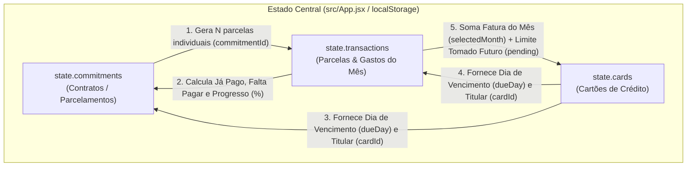
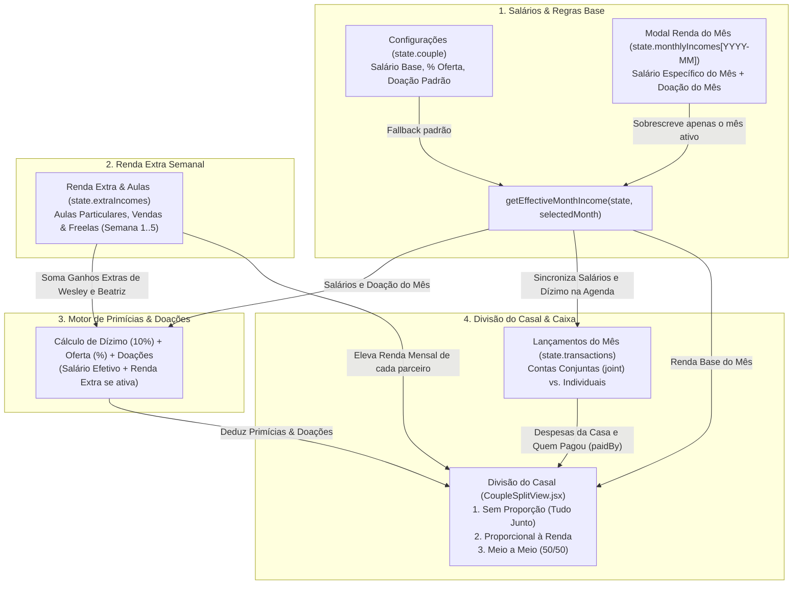
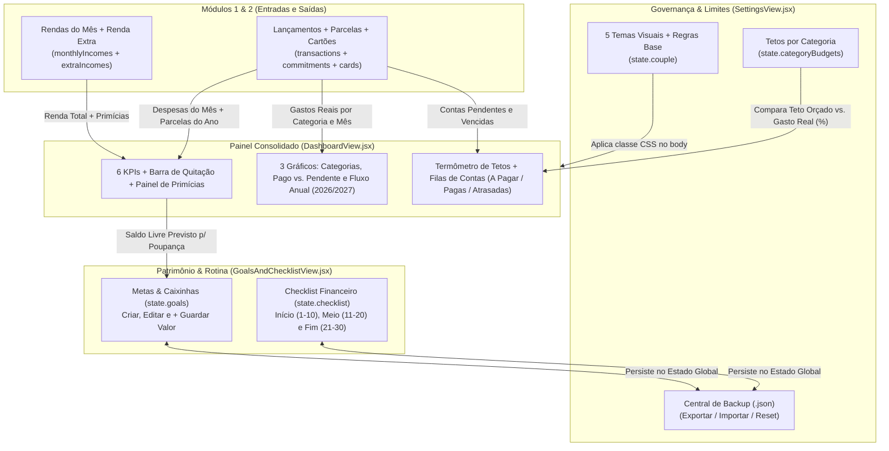

# 🗺️ FLUXOS_DO_SISTEMA.md — Arquitetura de Fluxos e Relacionamento de Dados do FinanPro!

Este documento mapeia de forma detalhada todas as funcionalidades do **FinanPro! | Finanças a Dois**, explicando como as telas se relacionam, trocam informações e mantêm a sincronização em tempo real através do estado central da aplicação.

---

## 📑 Índice de Módulos Mapeados

1. **[Módulo 1: Tríade de Despesas — Parcelados e Fixas, Lançamentos do Mês e Cartões & Faturas](#módulo-1-tríade-de-despesas--parcelados-e-fixas-lançamentos-do-mês-e-cartões--faturas)** *(Concluído)*
2. **[Módulo 2: Rendas Mensais, Renda Extra, Primícias (Dízimo/Oferta/Doação) e Divisão do Casal](#módulo-2-rendas-mensais-renda-extra-primícias-dízimoofertadoação-e-divisão-do-casal)** *(Concluído)*
3. **[Módulo 3: Visão Geral (Dashboard), Metas & Caixinhas e Central de Backup/Configurações](#módulo-3-visão-geral-dashboard-metas--caixinhas-e-central-de-backupconfigurações)** *(Concluído)*

---

# Módulo 1: Tríade de Despesas — Parcelados e Fixas, Lançamentos do Mês e Cartões & Faturas

## 1.1. Fonte Única de Verdade e Chaves de Ligação (`src/App.jsx`)

Toda a comunicação entre as abas **Parcelados e Fixas** (`src/components/CommitmentsView.jsx`), **Lançamentos do Mês** (`src/components/TransactionsView.jsx`) e **Cartões e Faturas** (`src/components/CardsView.jsx`) ocorre através do estado global gerenciado em `src/App.jsx` (persistido em `localStorage` sob a chave `finanpro_couple_state_v1`).

As três coleções principais se conectam por duas chaves estrangeiras (`commitmentId` e `cardId`):

* **`state.commitments`** *(Contratos-Mestre)*:
  * Armazena compras parceladas (1x a 48x) e contas fixas recorrentes (ex.: Aluguel, Internet, Seguro).
  * Campos-chave: `id`, `title`, `type` (`installment` | `recurring`), `category`, `totalAmount`, `downPayment`, `installmentsCount`, `startDate`, `endDate`, `paymentMethod`, `cardId`, `owner` (`joint` | `partner1` | `partner2`), `paidBy`.
* **`state.transactions`** *(Fluxo de Caixa Mensal e Parcelas Individuais)*:
  * Armazena cada parcela individual gerada por um compromisso e também os gastos/receitas avulsos lançados diretamente no mês.
  * Campos-chave: `id`, `commitmentId` *(liga ao contrato em `state.commitments`)*, `cardId` *(liga ao cartão em `state.cards`)*, `title`, `type` (`expense` | `income`), `category`, `amount`, `dueDate` (`YYYY-MM-DD`), `paidDate`, `status` (`pending` | `paid`), `owner`, `paidBy`, `paymentMethod`, `installmentNumber`, `totalInstallments`, `receiptFileName`.
* **`state.cards`** *(Cartões de Crédito do Casal)*:
  * Armazena os cartões cadastrados (ex.: *Inter Platinum — Wesley*, *Nubank Chroma — Beatriz*).
  * Campos-chave: `id`, `name`, `brand`, `owner`, `limit`, `closingDay`, `dueDay`, `color`.

### Diagrama de Relacionamento e Fluxo de Dados

---

## 1.2. Detalhamento Funcional de Cada Aba

### A) Aba: Parcelados e Fixas (`src/components/CommitmentsView.jsx`)

* **Propósito:** Visão macro de longo prazo de todos os compromissos que atravessam múltiplos meses, permitindo acompanhar a amortização de dívidas/parcelamentos e saber exatamente quando cada compromisso termina.
* **Indicadores (KPIs do Topo):**
  1. **Volume Total Contratado / Parcelado:** Soma de `totalScheduled` de todos os compromissos filtrados.
  2. **Total Já Amortizado / Quitado:** Soma de todas as parcelas vinculadas (`t.commitmentId === c.id`) que já estão com `status === 'paid'`.
  3. **Saldo Devedor Futuro (Para Quitar Tudo):** Diferença exata (`totalScheduled - totalPaid`), representando tudo o que ainda vencerá nos próximos meses.
* **Filtros Disponíveis:**
  * Busca textual por título (`search`).
  * Filtro por Cartão (`cardFilter`: Todos os Cartões/Meios ou cartão específico).
  * Filtro por Categoria (`categoryFilter`).
  * Filtro por Situação (`statusFilter`: *Qualquer Situação*, *Em Andamento* ou *100% Quitado*).
  * Respeita também o filtro global de titular da Topbar (`ownerFilter`: Casal, Conjunto, Wesley, Beatriz).
* **Regras de Criação (`Novo Parcelamento / Conta Fixa`):**
  * Permite selecionar onde foi feito: **Cartão de Crédito** (selecionando qual cartão) ou **PIX / Boleto / Débito**.
  * Ao selecionar um Cartão de Crédito, o dia do `startDate` assume automaticamente o `dueDay` daquele cartão e o `paidBy` assume o titular do cartão.
  * **Entrada Inicial Condicional (`hasDownPayment`):** Se marcada, gera a parcela `0` (`Entrada`) com status `paid` e divide apenas o saldo restante (`totalAmount - downPayment`). Ao desmarcar a checkbox, o estado `downPayment` é imediatamente zerado (`''`) para impedir resíduos de cálculo (Regra de Ouro #1).
  * **Ajuste Automático de Centavos (`schedulePreview`):** Calcula `baseSlice = Math.floor((remainingToDivide / count) * 100) / 100` para as primeiras `N - 1` parcelas e atribui `Number((remainingToDivide - sumPrev).toFixed(2))` na última parcela, garantindo que a soma das parcelas seja **100% idêntica** ao valor total contratado.
* **Ações por Linha e Exportação:**
  * **Ícone 👁️ (`Ver Cronograma de Parcelas`):** Abre modal exibindo todas as parcelas geradas (`#0`, `#1/N`... `#N/N`) com suas datas e permite alternar o status (`Pago` / `Pendente`) diretamente dentro do cronograma.
  * **Ícone 🗑️ (`Excluir Compromisso`):** Exclui o contrato e todas as suas parcelas em cascata.
  * **Botão `Exportar CSV`:** Gera arquivo `.csv` com os compromissos filtrados.

---

### B) Aba: Lançamentos do Mês (`src/components/TransactionsView.jsx`)

* **Propósito:** Funcionar como a agenda e livro-caixa operacional do mês selecionado (`state.selectedMonth`), reunindo receitas do mês, gastos avulsos e a parcela específica que vence naquele mês de cada compromisso parcelado/fixo.
* **Calendário Interativo de Vencimentos:**
  * Renderiza a grade mensal completa do `selectedMonth`.
  * Em cada dia do calendário, exibe:
    * Indicador `+R$` se houver receita naquele dia.
    * Indicador `💳 Vence [Nome do Cartão]` se algum cartão cadastrado tiver `dueDay` naquele dia.
    * Badge colorido com a quantidade de despesas do dia (`pending` em âmbar se houver conta em aberto; `paid` em verde se todas do dia estiverem pagas) e o somatório em R\$ do dia.
  * **Filtro por Clique Direto:** Clicar em um dia filtra a tabela abaixo para exibir exclusivamente os lançamentos daquela data (`selectedDay`).
* **Abas e Filtros da Listagem:**
  * **4 Sub-abas:** *Todos do Mês* (`all`), *Contas / Faturas a Pagar* (`pending`), *Histórico Pago* (`paid`) e *Receitas / Entradas* (`income`).
  * **Filtros Rápidos:** Busca por nome, filtro por Cartão / PIX (`cardFilter`) e filtro por Categoria (`categoryFilter`).
* **Fluxos de Baixa / Quitação:**
  * **Clique Rápido no Status:** Clicar no botão `Pendente` / `Pago` (ou `Recebido`) inverte o status imediatamente sem abrir modal.
  * **Botão `Quitar` (Modal com Comprovante):** Abre modal permitindo registrar a data exata do pagamento (`paidDate`), quem pagou (`paidBy`: Wesley ou Beatriz) e anexar o nome do arquivo de comprovante (`receiptFileName`, exibido com `📎` na tabela).

---

### C) Aba: Cartões e Faturas (`src/components/CardsView.jsx`)

* **Propósito:** Centralizar a gestão dos cartões de crédito do casal, separando o que deve ser pago na **Fatura do Mês Ativo** do que está comprometendo o **Limite Total do Cartão** com compras parceladas para os meses seguintes.
* **Indicadores Consolidados (KPIs do Topo):**
  1. **Soma das Faturas no Mês:** Soma de `monthInvoiceTotal` de todos os cartões no `selectedMonth`.
  2. **Limite Disponível Somado:** Soma de `availableLimit` de todos os cartões do casal.
  3. **Cartões Ativos do Casal:** Quantidade de cartões cadastrados.
* **Cálculos Financeiros por Cartão (`enrichedCards`):**
  * **Fatura do Mês (`monthInvoiceTotal` e `monthInvoicePending`):** Filtra todas as transações de despesa (`type === 'expense'`) vinculadas ao cartão (`t.cardId === card.id`) cujo `dueDate` começa com `selectedMonth`.
  * **Limite Tomado com Parcelas Futuras (`totalUsedLimit`):** Soma **todas** as transações com `t.cardId === card.id` e `t.status === 'pending'` em **qualquer mês** (atual ou futuro). Assim, uma compra de R\$ 1.800 em 3x de R\$ 600 mostra R\$ 600 na fatura do mês, mas bloqueia R\$ 1.800 do limite até que as parcelas sejam pagas.
  * **Limite Disponível (`availableLimit`):** Calculado como `Math.max(0, card.limit - totalUsedLimit)`.
* **Grade de 4 Ações por Cartão (`.cc-actions-grid`):**
  1. **`+ Lançar Gasto`**: Abre o modal global de nova transação já pré-configurado com `paymentMethod = 'Cartão de Crédito'`, `cardId = card.id`, `dueDate` no dia de vencimento do cartão e `paidBy` com o titular do cartão.
  2. **`Ver Fatura (N)`**: Abre modal listando todos os lançamentos e parcelas que compõem a fatura daquele cartão no `selectedMonth`.
  3. **`Editar Cartão`**: Abre modal permitindo editar Nome, Limite Total, Dia de Fechamento (`closingDay`), Dia de Vencimento (`dueDay`), Titular (`owner`), Bandeira (`brand`) e Cor (`color`).
  4. **`Pagar Fatura`**: Marca de uma só vez todas as transações pendentes daquele cartão no `selectedMonth` como `paid`.

---

## 1.3. Matriz de Sincronização Cruzada (Ação x Reação entre as 3 Abas)

A tabela abaixo documenta todas as reações automáticas do sistema quando o usuário executa uma operação em qualquer uma das três telas:

| Operação Executada | Função em `src/App.jsx` | Efeito em **Parcelados e Fixas** | Efeito em **Lançamentos do Mês** | Efeito em **Cartões e Faturas** |
| :--- | :--- | :--- | :--- | :--- |
| **Criar Parcelamento ou Conta Fixa** | `handleAddCommitment` | Adiciona o contrato-mestre na tabela com progresso inicial (`0%` ou entrada paga) e prazo final (`computedEndDate`). | Cria automaticamente **N lançamentos** (`tx-commId-1` ... `tx-commId-N`), distribuídos mês a mês na mesma data de vencimento. | Se vinculado a um cartão: soma a parcela do mês atual na **Fatura do Mês** e soma todas as N parcelas pendentes no **Limite Tomado** do cartão. |
| **Lançar Gasto Avulso no Mês** | `handleSaveTransaction` | *Sem alteração* (gasto único sem contrato multi-mês). | Insere o lançamento na tabela do mês e atualiza o contador e soma do dia no **Calendário de Vencimentos**. | Se vinculado a um cartão: define o vencimento no `dueDay` do cartão, soma na **Fatura do Mês** e reduz o **Limite Disponível**. |
| **Alternar Status de Parcela (`Pago` ↔ `Pendente`)** | `handleToggleTransactionStatus` / `handleQuickPayTransaction` | Recalcula instantaneamente **Já Pago**, **Falta Pagar**, fração `X/Y parc.` e a barra de **Progresso (%)** do contrato correspondente. | Atualiza o badge do item, move entre as abas *A Pagar* / *Histórico Pago* e atualiza a cor do dia no **Calendário**. | Se for de cartão: reduz/aumenta o valor em aberto da **Fatura do Mês** e libera/consome o **Limite Disponível** imediatamente. |
| **Clicar em "Pagar Fatura" no Cartão** | `handlePayFullCardInvoice` | Todas as compras parceladas naquele cartão têm a parcela do `selectedMonth` quitada, avançando o progresso (`%`) de todos os contratos daquele cartão. | Todos os lançamentos daquele cartão no `selectedMonth` passam para `Pago` na tabela e no Calendário. | A fatura do mês muda para **Fatura Quitada**, o botão muda para **Fatura Paga** e o valor pago retorna ao **Limite Disponível**. |
| **Editar Cartão (ex.: mudar Dia de Vencimento)** | `handleUpdateCard` | Atualiza o nome/cor do badge do cartão, o texto `Vence dia X` e a data de vencimento das parcelas futuras do contrato. | **Cascata automática:** Todas as transações `pending` daquele cartão têm seu `dueDate` atualizado para o novo dia (`YYYY-MM-novoDia`), mudando de casa no **Calendário**. | Atualiza o cartão visual, limites e a data de vencimento da fatura. |
| **Excluir Compromisso Parcelado** | `handleDeleteCommitment` | Remove o contrato da lista e atualiza os 3 KPIs de endividamento. | **Exclusão em cascata:** Remove todas as parcelas (`t.commitmentId === commId`) de todos os meses passados, presentes e futuros. | Retira as parcelas da fatura do mês e devolve todo o saldo pendente para o **Limite Disponível** do cartão. |
| **Excluir Lançamento Individual** | `handleDeleteTransaction` | Se o lançamento excluído era uma parcela de um contrato, recalcula o total agendado e o progresso daquele contrato. | Remove o item da tabela do mês e do **Calendário de Vencimentos**. | Se pertencia a um cartão, abate o valor da **Fatura do Mês** e libera o **Limite Disponível**. |

---

## 1.4. Sincronização com Controles Globais (`Topbar`)

* **Navegador de Meses (`selectedMonth` na Barra Superior):**
  * Ao avançar ou retroceder os meses (`< Novembro de 2026 >`), as abas **Lançamentos do Mês** e **Cartões e Faturas** recalculam automaticamente seus dados para o mês escolhido, permitindo visualizar faturas futuras (compostas pelas parcelas geradas em **Parcelados e Fixas**) ou consultar o histórico de meses anteriores.
* **Filtro Global de Titular (`ownerFilter` na Barra Superior):**
  * Ao selecionar *Casal (Tudo)*, *Apenas Conjunto*, *Wesley* ou *Beatriz*, as listagens e indicadores de **Parcelados e Fixas** e **Lançamentos do Mês** são filtrados simultaneamente pelo campo `owner`.

---

# Módulo 2: Rendas Mensais, Renda Extra, Primícias (Dízimo/Oferta/Doação) e Divisão do Casal

## 2.1. Estruturas de Dados Envolvidas (`src/App.jsx` & `src/utils/formatters.js`)

O fluxo de receitas, consagração de primícias (Dízimo 10% + Oferta % + Doações) e divisão de despesas do casal conecta 4 estruturas do estado global:

1. **`state.couple`** *(Configuração Base em `src/components/SettingsView.jsx`)*:
   * Define os parâmetros padrão do casal: nomes (`partner1Name`, `partner2Name`), salários habituais de referência (`partner1Income`, `partner2Income`), ativação e percentual do Dízimo (`titheEnabled`, `tithePercent = 10`), percentuais individuais de Oferta (`partner1OfferingPercent`, `partner2OfferingPercent`), doação padrão (`donationAmount`), inclusão da renda extra na base do dízimo (`includeExtraInTithe`) e modelo de divisão ativo (`splitMode`: `'unified'` | `'proportional'` | `'equal'`).
2. **`state.monthlyIncomes[YYYY-MM]` + `getEffectiveMonthIncome(state, selectedMonth)`** *(Renda Específica por Mês)*:
   * Dicionário indexado por ano-mês (`YYYY-MM`) que armazena o salário efetivo de Wesley (`partner1Income`), o salário efetivo de Beatriz (`partner2Income`) e as doações esporádicas (`donationAmount`) daquele mês específico.
   * Caso o mês ativo possua registro em `state.monthlyIncomes[selectedMonth]`, ele tem prioridade sobre `state.couple`; caso contrário, o sistema utiliza automaticamente os valores padrão de `state.couple` (*fallback*).
3. **`state.extraIncomes`** *(Ganhos Extras Semanais em `src/components/ExtraIncomeView.jsx`)*:
   * Lista todas as aulas particulares (`type: 'class'`), vendas (`type: 'sale'`) e serviços/freelas (`type: 'service'`).
   * Campos-chave: `id`, `title`, `type`, `studentOrClient`, `weekOfMonth` (`Semana 1` a `Semana 5`), `date` (`YYYY-MM-DD`), `hoursOrQty`, `unitPrice`, `amount` (`hoursOrQty * unitPrice`), `owner` (`partner1` | `partner2`), `status` (`received` | `pending`), `applyTitheAndOffering` (`boolean`).
4. **`state.transactions`** *(Agenda e Despesas do Mês em `src/components/TransactionsView.jsx`)*:
   * Fornece todas as despesas do mês ativo para o cálculo da **Divisão do Casal** (separando despesas conjuntas da casa `owner === 'joint'` e gastos individuais `owner === 'partner1' | 'partner2'`, além de identificar quem pagou via `paidBy`).
   * Recebe também a atualização automática dos lançamentos de `Salário Mensal` e de `Dízimo + Oferta` quando o usuário define a renda do mês.

### Diagrama de Relacionamento e Fluxo de Cálculo

---

## 2.2. Detalhamento Funcional e Regras Matemáticas

### A) Gestão de Salários Mensais Independentes (`MonthIncomeModal` em `src/App.jsx` e `SettingsView.jsx`)

* **Por que existe:** Permite que o casal informe quanto efetivamente recebeu em cada mês (ex.: R\$ 5.900 em um mês e um valor diferente no mês seguinte) sem que a alteração de um mês modifique os meses anteriores ou futuros.
* **Pontos de Acesso:**
  1. Botão **`Renda de [Mês]`** na Barra Superior (`Topbar`).
  2. Botão **`Editar Renda de [Mês]`** no card de Receita da aba **Visão Geral** (`DashboardView.jsx`).
  3. Botão **`Definir Renda do Mês`** no cabeçalho da aba **Divisão do Casal** (`CoupleSplitView.jsx`).
  4. Configuração de Salário Base padrão na aba **Configurações** (`SettingsView.jsx`).
* **Sincronização Automática ao Salvar (`handleSaveMonthIncome` em `src/App.jsx`):**
  * Grava `{ partner1Income, partner2Income, donationAmount }` dentro de `state.monthlyIncomes[selectedMonth]`.
  * Procura em `state.transactions` os lançamentos de receita (`type === 'income'`) de `partner1` e `partner2` naquele mês: se já existirem, atualiza seus valores (`amount`); se não existirem e o salário for maior que zero, cria automaticamente o lançamento no dia `05` do mês.
  * Procura em `state.transactions` os lançamentos da categoria `dizimo` daquele mês e recalcula automaticamente seus valores com base no novo salário do mês (`p1Sal * (10% + p1OffPct) / 100` e `p2Sal * (10% + p2OffPct) / 100`).

---

### B) Aba: Renda Extra — Aulas Particulares, Vendas & Serviços (`src/components/ExtraIncomeView.jsx`)

* **Propósito:** Controlar ganhos variáveis semana a semana (`Semana 1` a `Semana 5`), como aulas particulares dadas na semana, vendas de produtos ou serviços extras, prevendo quanto já entrou no bolso e quanto ainda falta receber dos alunos/clientes.
* **6 KPIs do Topo:**
  1. **Total Renda Extra no Mês:** Soma bruta (`totalGross`) e valor líquido livre após deduzir Dízimo e Oferta (`totalNet`).
  2. **Já Recebido (No Bolso):** Soma dos itens com `status === 'received'`.
  3. **Falta Receber (Previsto):** Soma dos itens com `status === 'pending'`.
  4. **Ganhos com Aulas:** Soma em R\$ e total de horas (`totalClassHours`) de aulas particulares no mês.
  5. **Ganhos com Vendas & Extras:** Soma em R\$ e quantidade de vendas/serviços no mês.
  6. **Dízimo + Oferta (Renda Extra):** Total consagrado sobre os ganhos extras do mês, detalhando quanto é Dízimo (10%) e quanto é Oferta (%).
* **Painel de Produção por Semana (`weeklySummary`):**
  * Agrupa os itens do mês nas 5 semanas (`Semana 1` a `Semana 5`), exibindo total bruto, valor recebido, valor a receber e total de horas de aula da semana.
  * Clicar no card de uma semana filtra a tabela abaixo imediatamente para mostrar apenas os registros daquela semana.
* **Cálculo de Primícia por Item (`computeItemTitheAndOffering`):**
  * Respeita o titular que realizou a atividade (`item.owner === 'partner1'` usa `partner1OfferingPercent`; `item.owner === 'partner2'` usa `partner2OfferingPercent`).
  * Se `item.applyTitheAndOffering` estiver marcado:
    * `tithe = gross * (tithePercent / 100)`
    * `offering = gross * (offeringPct / 100)`
    * `netAmount = gross - (tithe + offering)`

---

### C) Motor de Primícias (Dízimo 10% + Oferta %) e Doações Esporádicas

* **Fórmula Consolidada do Mês (usada em `DashboardView.jsx` e `CoupleSplitView.jsx`):**
  * **Base de Cálculo de cada Parceiro:**
    * `p1TitheBase = p1Salary + (couple.includeExtraInTithe ? p1Extra : 0)`
    * `p2TitheBase = p2Salary + (couple.includeExtraInTithe ? p2Extra : 0)`
  * **Consagração Individual (Dízimo + Oferta):**
    * `p1Consecrated = p1TitheBase * (10 + p1OfferingPercent) / 100`
    * `p2Consecrated = p2TitheBase * (10 + p2OfferingPercent) / 100`
  * **Doações Esporádicas / Caridade (`donationAmount`):**
    * Valor fixo em R\$ definido pelo casal (no mês ou nas configurações) para ações sociais, ajuda a familiares ou doações fora do dízimo e oferta.
  * **Total de Primícias & Doações do Mês:**
    * `totalConsecrated = p1Consecrated + p2Consecrated + donationAmount`

---

### D) Aba: Divisão do Casal (`src/components/CoupleSplitView.jsx`)

* **Propósito:** Reunir todas as rendas (Salários do Mês + Renda Extra), deduzir as Primícias & Doações e apresentar a distribuição das despesas da casa conforme a filosofia escolhida pelo casal.
* **3 Modos de Divisão Alternáveis em 1 Clique (`splitMode`):**
  1. **`🤝 Sem Proporção / Tudo Junto` (`splitMode === 'unified'`):**
     * Trata 100% dos ganhos de Wesley e Beatriz como um **Orçamento Familiar Único** ("todo o dinheiro que ganhamos é para os dois").
     * **Zero dívidas internas:** O banner principal celebra a união financeira sem transferências entre o casal, oculta as colunas de divisão proporcional na tabela de contas da casa e destaca a **Contribuição Líquida p/ Família** e o **Saldo Livre do Casal** (`totalCoupleIncome - totalConsecrated - totalAllExpenses`).
  2. **`% Proporcional à Renda` (`splitMode === 'proportional'`):**
     * Calcula a participação de cada um na renda total do mês (Salário Efetivo + Renda Extra):
       * `p1ShareRatio = p1Income / totalCoupleIncome`
       * `p2ShareRatio = 1 - p1ShareRatio`
     * Define a quota justa de cada um nas despesas conjuntas (`owner === 'joint'`):
       * `p1TargetJointContribution = totalJoint * p1ShareRatio`
       * `p2TargetJointContribution = totalJoint * p2ShareRatio`
     * Confronta a quota justa com o que cada um efetivamente pagou das contas conjuntas (`p1PaidForJoint`, apurado pelo campo `paidBy` das transações) e calcula o acerto exato (`p1BalanceDiff = p1PaidForJoint - p1TargetJointContribution`).
  3. **`= Meio a Meio (50/50)` (`splitMode === 'equal'`):**
     * Fixa `p1ShareRatio = 0.5` e `p2ShareRatio = 0.5` para todas as despesas conjuntas da casa (`owner === 'joint'`) e calcula o acerto mensal entre os dois.
* **Exportação para WhatsApp (`handleSendWhatsAppSummary`):**
  * Gera um resumo formatado para envio direto no WhatsApp do casal, adaptando automaticamente o texto caso o modo ativo seja *Tudo Junto (Sem Proporção)* ou *Proporcional / 50-50*.

---

## 2.3. Matriz de Sincronização Cruzada (Módulo 2)

| Operação Executada | Onde é feita | Impacto em **Renda Extra & Aulas** | Impacto em **Lançamentos do Mês** | Impacto em **Divisão do Casal & Visão Geral** |
| :--- | :--- | :--- | :--- | :--- |
| **Definir Salário ou Doação específica de um Mês** (`handleSaveMonthIncome`) | Modal **`Renda de [Mês]`** (Topbar, Dashboard ou Divisão) | *Não altera* os ganhos extras, mas soma-se a eles na renda total do mês. | Atualiza (ou cria no dia 05) os lançamentos de **Salário Mensal** de Wesley e Beatriz e recalcula os lançamentos de **Dízimo + Oferta** daquele mês. | Atualiza imediatamente a **Renda Familiar Total**, o cálculo de **Primícias & Doações**, o **Saldo Livre** e (no modo Proporcional) os percentuais de divisão apenas daquele mês. |
| **Alterar `% de Oferta` ou Salário Base** (`handleUpdateCoupleSettings`) | **Configurações** (`SettingsView.jsx`) | Recalcula instantaneamente a coluna **Dízimo + Oferta** e o KPI de primícias de todas as aulas e vendas em `ExtraIncomeView`. | Serve de base para os próximos meses que não possuírem renda customizada. | Recalcula o card de **Primícias da Renda**, a consagração individual de Wesley/Beatriz e o **Saldo Livre do Casal**. |
| **Registrar Aula Particular ou Venda** (`handleAddExtraIncome`) | **Renda Extra & Aulas** (`ExtraIncomeView.jsx`) | Adiciona o item na semana correspondente (`Semana 1..5`), soma nas horas de aula ou vendas e calcula o Dízimo + Oferta do item. | *Mantido separado* da tabela de contas a pagar para não poluir a agenda de boletos/faturas com dezenas de aulas semanais. | Soma automaticamente na renda do parceiro (`p1Extra` ou `p2Extra`), eleva a **Renda Familiar Total**, ajusta a **Primícia** (se `includeExtraInTithe` estiver ativo) e aumenta o **Saldo Livre**. |
| **Alternar Modo de Divisão (`Tudo Junto`, `Proporcional`, `50/50`)** | **Divisão do Casal** ou **Configurações** | *Sem alteração.* | *Sem alteração.* | Alterna o banner de acerto, exibe/oculta as colunas de quota na tabela de despesas da casa e adapta o texto do resumo para WhatsApp. |
| **Lançar ou Editar Despesa Conjunta (`owner: 'joint'`)** | **Lançamentos do Mês**, **Parcelados** ou **Cartões** | *Sem alteração.* | Entra na agenda do mês com o badge `Conjunto (Casa)` e registra quem pagou (`paidBy`). | Entra na tabela **Detalhamento das Despesas da Casa**, reduz o **Saldo Livre do Casal** e atualiza quanto cada parceiro já pagou pela casa (`p1PaidForJoint` / `p2PaidForJoint`). |

---

# Módulo 3: Visão Geral (Dashboard), Metas & Caixinhas e Central de Backup/Configurações

## 3.1. Arquitetura de Agregação, Patrimônio e Governança

O **Módulo 3** é a camada estratégica do **FinanPro!**, responsável por consolidar todos os dados gerados nos Módulos 1 e 2 em indicadores executivos, direcionar o saldo livre para os objetivos do casal e garantir a segurança/portabilidade dos dados:

1. **`src/components/DashboardView.jsx`** *(Painel Agregador em Tempo Real)*:
   * Não armazena listas próprias; consome e cruza em tempo real `state.monthlyIncomes`, `state.extraIncomes`, `state.transactions`, `state.commitments`, `state.couple` e `state.categoryBudgets`.
2. **`src/components/GoalsAndChecklistView.jsx`** *(Patrimônio e Rotina Mensal)*:
   * Gerencia `state.goals` (Caixinhas/Metas financeiras com criação, edição, aporte rápido e exclusão) e `state.checklist` (tarefas mensais divididas nos blocos de dias `01–10`, `11–20` e `21–30`).
3. **`src/components/SettingsView.jsx`** *(Governança Global, Tetos, Temas e Backup)*:
   * Gerencia `state.categoryBudgets` (tetos máximos de gasto por categoria), `state.couple.theme` (5 temas dinâmicos no `<body>`) e a exportação/importação integral do `state` em `.json`.
4. **Botão Flutuante de Ações Rápidas (`FAB` em `src/App.jsx`)**:
   * Disponível em todas as telas no canto inferior direito (`⚡ Ações Rápidas`), permitindo disparar a qualquer momento: **Novo Gasto (Cartão/Pix)**, **Nova Receita**, **Novo Parcelamento / Fixa**, **Ir para Aulas & Renda Extra** ou **Guardar nas Caixinhas**.

### Diagrama de Relacionamento e Fluxo de Dados (Módulo 3)

---

## 3.2. Detalhamento Funcional de Cada Aba

### A) Aba: Visão Geral / Dashboard (`src/components/DashboardView.jsx`)

* **Hero Banner & Ações Rápidas:**
  * Exibe saudação personalizada para `Wesley & Beatriz` e informa o **Saldo Livre Previsto** no mês (`freeBalance = totalIncome - totalExpense`), mudando para alerta vermelho caso as despesas superem a renda do mês.
  * Botões de ação imediata: **`Renda de [Mês]`**, **`+ Nova Despesa`**, **`Aulas & Renda Extra`** e **`Novo Parcelamento`**.
* **Painel de Fidelidade (Dízimo 10% + Ofertas + Doações):**
  * Calcula e exibe o valor total consagrado no `selectedMonth` (somando Salários Efetivos do Mês + Renda Extra, caso `includeExtraInTithe` esteja ativo), separando as pílulas individuais de Wesley e Beatriz.
* **Barra de Progresso de Quitação do Mês e Exportação PDF:**
  * Mostra o percentual de contas pagas no mês (`paidPercentage = (totalPaidExpense / totalExpense) * 100`), mensagem motivacional dinâmica, percentual de comprometimento da renda (`committedIncomePct`) e botão **`Relatório PDF`** (`window.print()`, com folha de estilo `@media print` otimizada).
* **6 KPIs Principais:**
  1. *Renda Total do Mês*: `Salários do Mês + Renda Extra do Mês`.
  2. *Total de Contas do Mês*: Soma das despesas do mês comparada ao *Teto Orçado* (`totalBudgetCeiling`).
  3. *Já Pago*: Total em R\$ e `%` de contas quitadas.
  4. *Restante (A Pagar)*: Total em R\$ e `%` pendente no mês.
  5. *Saldo Livre Previsto*: Sobra prevista comparada à *Meta Mensal de Poupança* (`couple.monthlySavingsTarget`).
  6. *Próximo Vencimento*: Identifica a próxima conta `pending` ordenada por `dueDate` e calcula quantos dias faltam (`getDaysDiffFromToday`).
* **3 Gráficos Interativos (Chart.js):**
  1. **Rosca — Gastos por Categoria:** Distribuição percentual e em R\$ das despesas do mês ativo.
  2. **Rosca — Pago vs. Restante no Mês:** Proporção de adimplência do mês + resumo rápido de *Gastos Conjuntos (Casa)* vs. *Individuais*.
  3. **Barras — Fluxo de Caixa Anual (`2026` / `2027`):** Projeta o desembolso de todos os 12 meses do ano selecionado (`Jan` a `Dez`), somando contas fixas e parcelas futuras geradas em **Parcelados e Fixas**. Calcula o **Volume Anual**, a **Média Mensal Ativa** e o **Mês de Maior Impacto (Pico)**, permitindo enxergar o *Alívio de Caixa Futuro* conforme os parcelamentos terminam.
* **Termômetro de Limites de Orçamento vs. Gasto Real por Categoria:**
  * Compara `cat.spent` (soma das transações daquela categoria no mês) com `cat.budget` (definido em **Configurações**).
  * Classificação visual automática: **Verde (`emerald`)** até 79%, **Âmbar (`warning`)** entre 80% e 100%, e **Vermelho (`danger`)** acima de 100%.
* **3 Listas Operacionais de Rodapé:**
  * *Próximas Contas a Pagar*: Top 5 contas pendentes com botão **`Pagar`** em 1 clique (`onQuickPayTransaction`).
  * *Últimos Pagamentos Realizados*: Top 5 contas pagas recentemente com identificação de quem pagou (`paidBy`).
  * *Contas em Atraso no Mês*: Alerta de contas `pending` com `dueDate` vencido.

---

### B) Aba: Metas, Caixinhas & Checklist Mensal (`src/components/GoalsAndChecklistView.jsx`)

* **Barra de Patrimônio Acumulado nas Caixinhas:**
  * Soma o saldo guardado em todas as metas (`totalSavedAll`) frente à meta global somada (`totalTargetAll`), exibindo o percentual total alcançado (`overallGoalsPct%`).
* **Gestão Completa de Caixinhas / Metas (`state.goals`):**
  * Cada card de meta exibe: Ícone colorido, Categoria, Título, Estratégia/Observações (`notes`), **Guardado**, **Meta Total**, **Falta**, Barra de Progresso e **Prazo** (`deadline`).
  * **Operações disponíveis:**
    * **`+ Nova Meta / Caixinha` (`handleAddGoal`)**: Cria um novo objetivo financeiro.
    * **`Editar Meta / Caixinha` (Ícone ✏️ `handleUpdateGoal`)**: Abre o modal preenchido permitindo alterar título, valor da meta, saldo guardado, prazo, categoria, cor e estratégia.
    * **`+ Guardar Valor` (`handleDepositGoal`)**: Abre modal focado em aporte rápido, simulando em tempo real o novo saldo acumulado antes de confirmar.
    * **`Excluir Meta` (Ícone 🗑️ `handleDeleteGoal`)**: Remove a caixinha.
* **Checklist de Rotina Financeira do Mês (`state.checklist`):**
  * Organizado em 3 blocos cronológicos fixos:
    1. *Início do Mês (Dia 01 a 10)*
    2. *Meio do Mês (Dia 11 a 20)*
    3. *Fechamento & Revisão do Casal (Dia 21 a 30)*
  * Permite marcar/desmarcar itens concluídos (`handleToggleChecklist`), adicionar novas tarefas em qualquer bloco (`handleAddChecklistItem`) e excluir tarefas (`handleDeleteChecklistItem`).

---

### C) Aba: Configurações, Tetos, Temas & Central de Backup (`src/components/SettingsView.jsx`)

* **Seletor de 5 Temas Visuais (`THEMES`):**
  * Opções: *Emerald Couple* (`theme-emerald`), *Rose Romance* (`theme-rose`), *Royal Navy* (`theme-navy`), *Soft Sage* (`theme-sage`) e *Midnight Dark* (`theme-dark`).
  * Ao selecionar um tema, atualiza `state.couple.theme`, que aplica a classe correspondente no `<body>` e altera instantaneamente todas as variáveis CSS (`--primary`, `--bg-main`, `--bg-card`, `--text-main`, etc.) em todas as telas.
* **Tetos de Gastos Mensais por Categoria (`state.categoryBudgets`):**
  * Define o limite mensal planejado em R\$ para cada uma das 9 categorias do sistema.
  * Exibe barra superior mostrando quanto os tetos somados (`totalBudgetAllocated`) representam em percentual da Renda Base do casal (`allocationPct%`).
* **Central de Backup & Portabilidade (`.json`):**
  * **Exportar Backup Completo (`handleExportBackup`):** Gera e baixa o arquivo `finanpro_backup_YYYY-MM.json` contendo 100% do estado da aplicação.
  * **Importar / Restaurar Backup (`handleImportBackup`):** Lê um arquivo `.json` do computador/celular e restaura todas as abas imediatamente.
  * **Restaurar Dados de Demonstração (`handleResetToDemo`):** Restaura o estado inicial de demonstração (`INITIAL_STATE`).

---

## 3.3. Matriz de Sincronização Cruzada (Módulo 3)

| Operação Executada | Onde é feita | Efeito em **Visão Geral (Dashboard)** | Efeito em **Metas & Caixinhas** | Efeito nas **Demais Abas (Módulos 1 e 2)** |
| :--- | :--- | :--- | :--- | :--- |
| **Clicar em "Pagar" na fila de Próximas Contas ou Atrasadas** (`handleQuickPayTransaction`) | **Visão Geral (Dashboard)** | Aumenta o KPI **Já Pago**, avança a **Barra de Quitação (%)**, atualiza o gráfico *Pago vs. Restante* e move o item para *Últimos Pagamentos*. | *Sem alteração direta.* | Marca o item como `Pago` em **Lançamentos do Mês**, avança o progresso em **Parcelados e Fixas** e libera limite em **Cartões e Faturas**. |
| **Alterar Tetos de Gastos por Categoria** (`handleUpdateCategoryBudgets`) | **Configurações** (`SettingsView.jsx`) | Atualiza o KPI *Teto Orçado* e recalcula imediatamente todos os cards e barras de alerta (`Verde` / `Âmbar` / `Vermelho`) do painel **Limites de Orçamento vs. Gasto Real**. | *Sem alteração.* | *Sem alteração.* |
| **Criar, Editar ou Guardar Valor em uma Caixinha** (`handleAddGoal` / `handleUpdateGoal` / `handleDepositGoal`) | **Metas & Caixinhas** (`GoalsAndChecklistView.jsx`) | *Sem alteração direta nos gastos*, mantendo o patrimônio separado das despesas correntes. | Recalcula a **Barra de Patrimônio Guardado**, o percentual global (`overallGoalsPct%`) e o progresso individual da Caixinha. | É salvo automaticamente no `localStorage` e incluído na exportação da **Central de Backup (`.json`)**. |
| **Trocar o Tema Visual** (`onUpdateCoupleSettings({ theme })`) | **Configurações** (`SettingsView.jsx`) | Aplica a nova paleta de cores nos cards, banners e textos da Visão Geral. | Aplica a nova paleta nas Caixinhas e no Checklist. | Muda instantaneamente o visual de todas as 8 abas e modais do sistema. |
| **Importar Arquivo de Backup (`.json`)** (`handleImportBackup`) | **Configurações** (`SettingsView.jsx`) | Recarrega todos os KPIs, gráficos e filas com os dados do arquivo importado. | Restaura todas as Caixinhas, saldos guardados e itens do Checklist. | Restaura integralmente Cartões, Parcelamentos, Lançamentos, Renda Extra e Rendas Mensais. |
